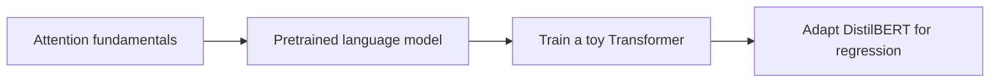

# NLP & Transformer Labs

**From attention with NumPy to a trainable toy Transformer and review-rating regression.**

Individual academic solutions by **Aitana Cantó Rico** for **COMPX328 - Natural Language Processing**, University of Waikato, New Zealand, during the 2025 international study period.



| Lab | What it demonstrates |
| --- | --- |
| [01 - Attention](labs/01-attention/) | NumPy attention, scaled attention, self-attention and multiple heads; PyTorch gradient updates |
| [02 - Small language model](labs/02-small-language-model/) | SmolLM2-135M-Instruct tokenisation, generation and terminal conversation |
| [03 - Toy Transformer](labs/03-toy-transformer/) | Synthetic selective-copying data, embeddings, a two-layer Transformer, training and validation |
| [04 - Review-rating regression](labs/04-review-rating-regression/) | DistilBERT regression with Hugging Face Trainer and a manual PyTorch training loop |

## Run

Install the dependencies in an activated virtual environment:

```bash
python -m pip install -r requirements.txt
python labs/03-toy-transformer/assignment3.py
```

Lab 03 generates synthetic data locally. Labs 02 and 04 download pretrained models; lab 04 also downloads Yelp Review Full. See [setup](docs/SETUP.md) for environment commands and [experiment notes](docs/EXPERIMENTS.md) for the scope and known limitations.

These are course exercises built on supplied scaffolding. They demonstrate different parts of the NLP workflow, rather than a production chatbot or a large-scale model benchmark.

[Academic context and sources](docs/ACADEMIC_CONTEXT.md)
